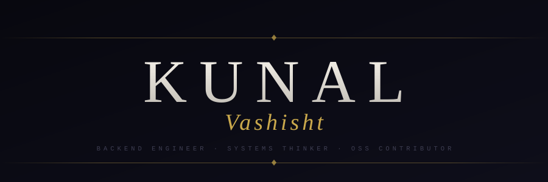

<div align="center">

<picture>
  <source media="(prefers-color-scheme: light)" srcset="https://readme-typing-svg.demolab.com?font=Cormorant+Garamond&weight=600&size=62&duration=100&pause=9999999&color=2A2318&center=true&vCenter=true&repeat=false&width=760&height=105&lines=KUNAL+VASHISHT"/>
</picture>

<p align="center">
  
</p>

<br/>

[](https://kunal649.github.io/portfolio)
&nbsp;
[](https://linkedin.com/in/kunal-vashisht-352mk)
&nbsp;
[](mailto:kunalv672005@gmail.com)

<br/><br/>

<i>The frontend gets the applause.<br/>I keep the lights on.</i>

</div>

<br/>

---

### `// open-source`

<div align="center">

[](https://github.com/mapeditor/tiled)

&nbsp;&nbsp;

[](https://github.com/mapeditor/tiled)

&nbsp;&nbsp;

[](https://github.com/mapeditor/tiled/pulls?q=author%3Akunal649+is%3Amerged)

&nbsp;&nbsp;

[](https://github.com/mapeditor/tiled/releases/tag/v1.12.1)

</div>

<br/>

--

### `// runtime`

```
node.js     event loop  ·  streams & backpressure  ·  worker threads
            child_process  ·  IPC  ·  libuv internals

backend     REST API design  ·  express.js  ·  socket.io  ·  JWT  · nginx

data        postgresql  —  joins  ·  transactions  ·  indexing

systems     C++  ·  large codebase navigation

tools       git  ·  linux / fedora  ·  docker  ·  postman  ·  pm2
```

<br/>

---

<div align="center">

<sub>building the parts you never see</sub>

</div>
