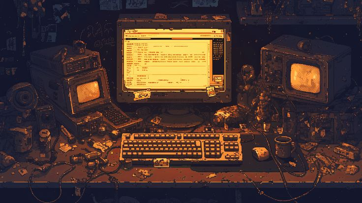

Backend and systems engineer. 

 

Intern @Indiabulls Securities - building an error-tracking SDK in TypeScript from scratch for their trading platform. 

Open source:  
- 4 merged PRs in [mapeditor/tiled](https://github.com/mapeditor/tiled), ([#4434](https://github.com/mapeditor/tiled/pull/4434), [#4426](https://github.com/mapeditor/tiled/pull/4426), [#4409](https://github.com/mapeditor/tiled/pull/4409), 
[#4397](https://github.com/mapeditor/tiled/pull/4397)), 
- credited in the [v1.12.1 release](https://github.com/mapeditor/tiled/releases/tag/v1.12.1).

- open discussion in [get-sentry/sentry-javascript](https://github.com/getsentry/sentry-javascript) - [createReduxEnhancer: how to capture rejected createAsyncThunk actions](https://github.com/getsentry/sentry-javascript/discussions/24852)

<!-- Add after your first Sentry PR is open:
Open source: contributing to [getsentry/sentry-javascript](https://github.com/getsentry/sentry-javascript) - [#PR_NUMBER](https://github.com/getsentry/sentry-javascript/pull/PR_NUMBER)
-->

 

&nbsp;&nbsp;
&nbsp;&nbsp;
&nbsp;&nbsp;
&nbsp;&nbsp;
&nbsp;&nbsp;
&nbsp;&nbsp;
&nbsp;&nbsp;
&nbsp;&nbsp;
&nbsp;&nbsp;
&nbsp;&nbsp;
&nbsp;&nbsp;
&nbsp;&nbsp;
&nbsp;&nbsp;

 

Open to internships - [kunalv672005@gmail.com](mailto:kunalv672005@gmail.com)

 

